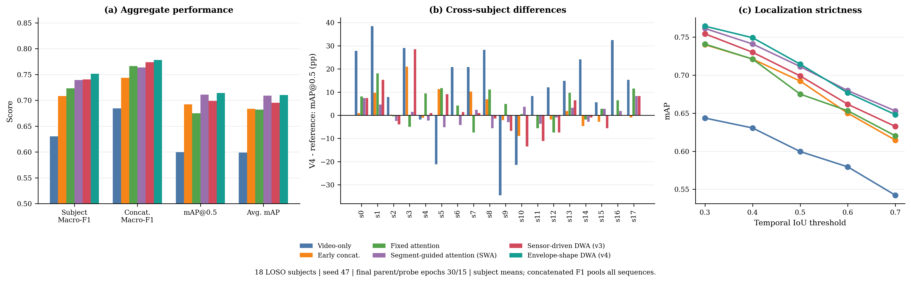
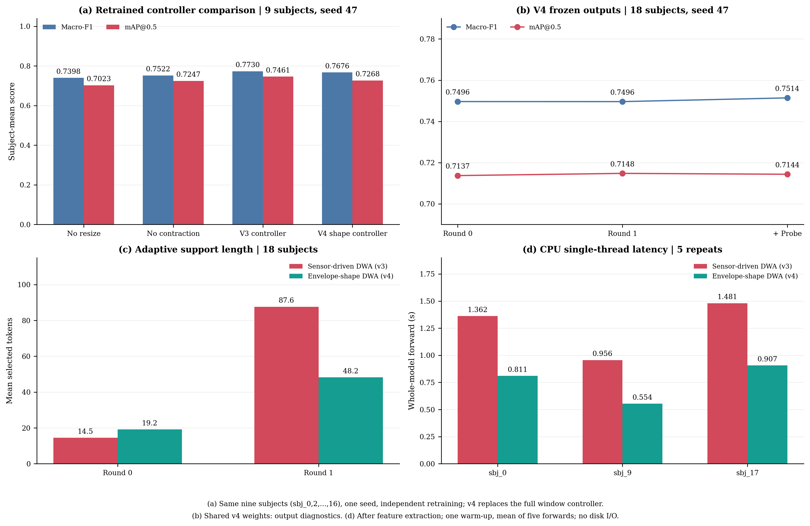
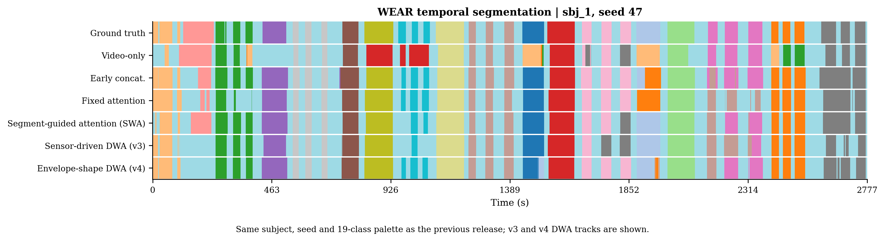
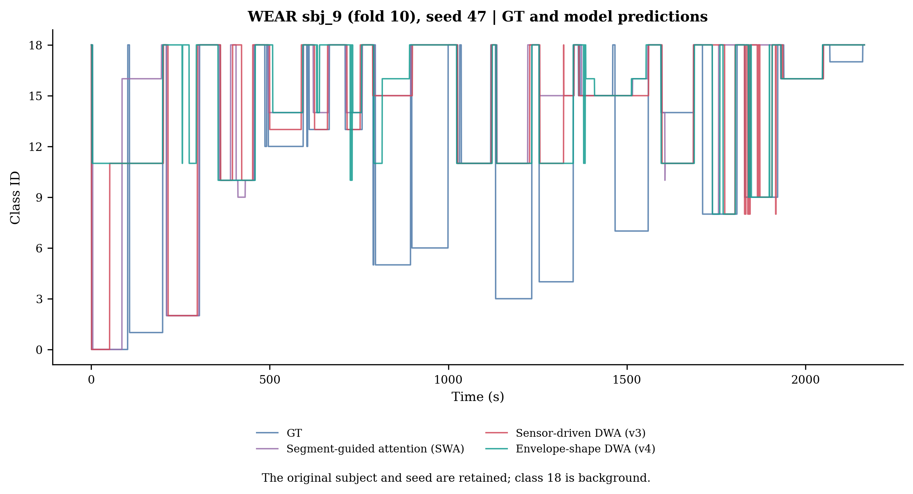
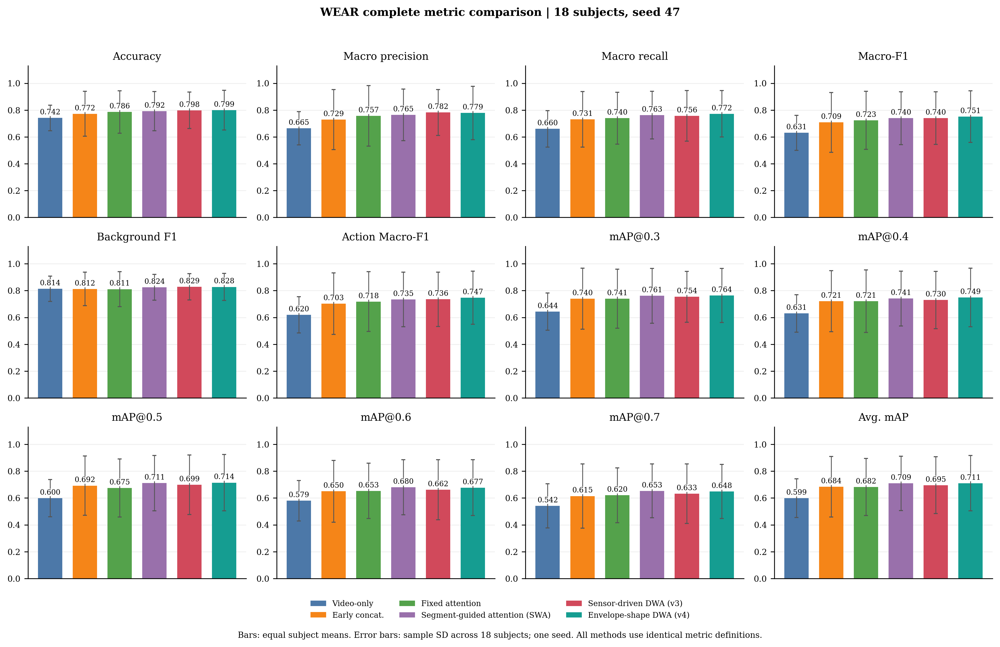
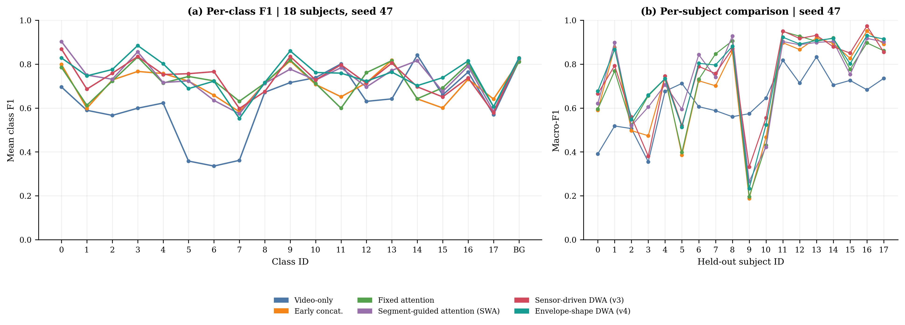

# WEAR envelope-shape DWA (v4): seed 47

All six main methods use the same 18 LOSO subjects and seed 47. The earlier
v3 three-seed table is separate. Parent/probe training uses fixed last epochs
30/15 and training-only normalization/calibration.

| Method | Subject Macro-F1 (mean +/- SD) | Concatenated Macro-F1 | Accuracy | mAP@0.5 | Avg mAP |
|---|---:|---:|---:|---:|---:|
| Video-only MS-TCN | 0.6305 +/- 0.1312 | 0.6844 | 0.7420 | 0.5996 | 0.5991 |
| Early concatenation | 0.7085 +/- 0.2230 | 0.7438 | 0.7724 | 0.6922 | 0.6836 |
| Fixed-window attention | 0.7233 +/- 0.2167 | 0.7663 | 0.7860 | 0.6750 | 0.6820 |
| Segment-guided Window Attention (SWA) | 0.7396 +/- 0.1969 | 0.7636 | 0.7918 | 0.7112 | 0.7092 |
| Sensor-driven DWA (v3) | 0.7405 +/- 0.1958 | 0.7739 | 0.7984 | 0.6989 | 0.6955 |
| **Envelope-shape DWA (v4)** | **0.7514 +/- 0.1926** | **0.7782** | **0.7994** | **0.7144** | **0.7105** |

Controller component comparisons use the same nine odd folds and seed 47.
Frozen output rows share v4 weights; they are not independently retrained
component removals. All directions of change are retained in the tables.

| Input | Contents |
|---|---|
| `aggregate_metrics.csv` | Twelve complete-model metrics, concatenated F1 and subject SDs |
| `per_subject_metrics.csv` | Six main methods and two frozen diagnostics, each on 18 subjects |
| `control_metrics.csv`, `ablation_aggregate_metrics.csv` | Matched nine-subject, seed-47 controller comparison |
| `paired_comparisons.csv`, `paired_statistics.json` | Paired subject differences and statistics |
| `per_class_metrics.csv` | Class F1, precision, recall and support |
| `window_behavior.csv` | Initial/selected support and shrink/expand proportions |
| `inference_timing.csv` | All CPU forward repetitions, including both rounds and probe |
| `timeline_sbj_1.csv`, `timeline_sbj_9.csv` | Original qualitative subjects and class palette |
| `manifest.json`, `prediction_sources.json` | Portable provenance and SHA-256 checks |

Redraw these figures without data or weights:

```bash
python scripts/plot_shape_results.py --output outputs/wear_shape_figures
```

The [reproduction guide](../../docs/envelope_shape_pilot.md) also covers
released weights, end-to-end score regeneration and retraining. The combined
[PDF gallery](https://github.com/shureduan/TGIF-Multimodal-Temporal-Segmentation/releases/download/wear-shape-v4-20261020/WEAR_envelope_shape_DWA_results.pdf)
is available with the weights.

## Main comparison: 18 subjects, seed 47



## Controller comparison, frozen outputs, windows and speed



## Temporal segmentation: sbj_1



## Ground truth and predictions: sbj_9



## All twelve metrics



## Per-class and per-subject results


